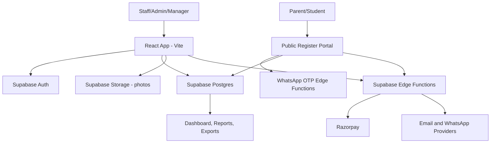
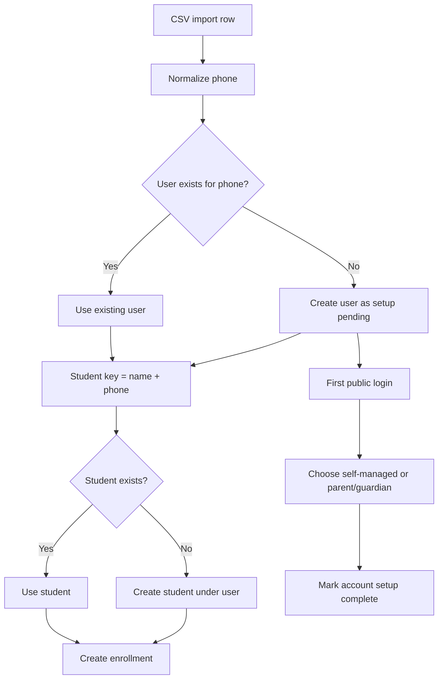
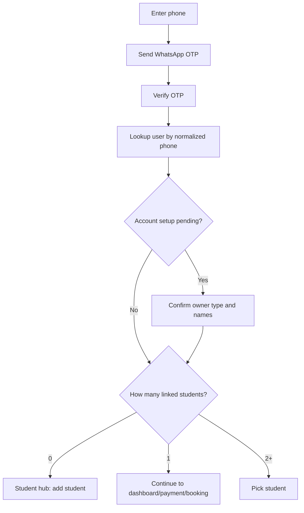
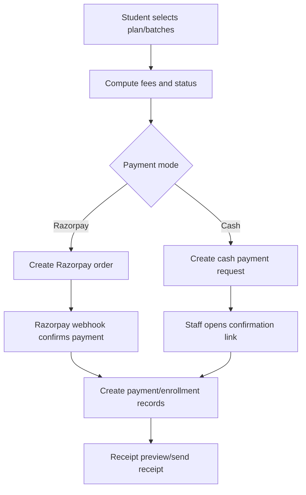

# Hashtag System

Hashtag System is the operating platform for managing studios, users, students, batches, subscriptions, enrollments, attendance, drop-ins, payments, receipts, imports, and student self-registration.

Production app: Vercel deployment, backed by Supabase.

## Quick Links

- Staff login: `/login`
- Student registration portal: `/register`
- Cash confirmation link: `/confirm-cash?token=...`
- Main dashboard: `/`
- Data import: `/import`
- Settings: `/settings`

## Who This Manual Is For

This README is both a user manual and a system SOP.

- Managers use it to run day-to-day operations: registrations, enrollments, payments, attendance, imports, and reporting.
- Admins use it to configure studios, staff, roles, cycles, plans, settings, and migration-sensitive data.
- Developers use it to understand the architecture, flows, and deployment process.

## Core Data Model

The public account structure is:

```text
users -> students -> enrollments
```

- `users` are account owners. They may be a parent, guardian, staff member, or self-managed student.
- `students` are the people attending classes.
- `enrollments` connect a student to one batch for a valid date/cycle range.
- One user can manage many students.
- Phone number is unique per user account after normalization.
- Students imported with the same phone number are grouped under the same user.
- Imported enrollment users are marked as setup pending. On first login, the user confirms whether the account is self-managed or parent/guardian managed and can correct owner and student names.

## Role Access

| Role | Main Access |
| --- | --- |
| Admin | Full system access, staff/user setup, all records, approvals, imports, settings. |
| Manager | Most operational access. Can be unrestricted or scoped to assigned studios, batches, and extra students. |
| Frontdesk | Students, studios, enrollments, drop-ins, payments, attendance. |
| Instructor | Instructor dashboard, assigned classes, attendance, reports, student visibility. |

If a user has no staff role record, the app currently treats them like unrestricted staff for sidebar visibility. Admins should keep role assignment clean.

## Manager User Manual

### 1. Login

1. Open `/login`.
2. Enter staff email and password.
3. If password is forgotten, use `Forgot password?`.
4. After login, use the left sidebar to navigate.

### 2. Dashboard

Use `Dashboard` to review operating performance by cycle and studio.

Common manager checks:

- Select the active cycle or a past cycle.
- Filter by studio when needed.
- Review total enrollments, new students, renewals, revivals, carry-forward records, revenue, headcount, renewable students, and absence thresholds.
- Click expandable sections for drill-down records.
- Use batch detail popups to inspect batch-level numbers.

Daily SOP:

1. Open Dashboard.
2. Confirm the active cycle is correct.
3. Review studio totals.
4. Check unusually low attendance or high missed-class counts.
5. Follow up on renewal or revival candidates.

### 3. Students

Use `Students` to find, create, edit, and delete student records.

Search:

- Search by student name.
- Search by student phone.
- Search also checks linked account owner phone.

Add student:

1. Click `Add Student`.
2. Find or create the linked account owner.
3. Enter student details.
4. Save.

Important rules:

- Student phone/email can be blank if the parent/account owner phone/email should be used.
- Contact display falls back from student contact to linked user contact.
- Deleting a student removes that student record and can affect enrollments, attendance, and payments linked to the student.

### 4. Users

Use `Users` to manage account owners and staff.

User records can represent:

- Staff members.
- Parents/guardians.
- Self-managed students.
- Imported account owners.

Add or edit a user:

1. Open `Users`.
2. Click `Add User` or edit an existing user.
3. Enter name, email, phone, source, and optional photo.
4. Select one or more roles.
5. Click the star beside a selected role to make it primary.
6. Save.

Create staff login:

1. Find the user in `Users`.
2. Click the key icon if the user has no login account.
3. Enter email and a temporary password.
4. Save and share credentials securely with the staff member.

Manager scope:

- A manager can be unrestricted or scope-restricted.
- If scope restricted is on, they only see students in assigned studios, batches where they are an instructor, and manually selected extra students.
- Studio ownership is configured on `Studios`.
- Instructor assignment is configured on `Batches`.

### 5. Studios

Use `Studios` to manage locations.

Fields:

- Studio name.
- Studio code.
- Address.
- Google Maps URL.
- Wingperson.
- Dreamcatcher.

SOP:

1. Create the studio before creating batches.
2. Keep studio code short and consistent because imports and batch codes depend on codes.
3. Assign responsible users where applicable.

### 6. Batches

Use `Batches` to manage recurring class groups.

Batch fields:

- Name.
- Style base.
- Level.
- Studio.
- Instructor and second instructor.
- Capacity.
- Weekly schedule.
- Generated batch code.

SOP:

1. Create or verify studio first.
2. Add batch with style, level, studio, schedule, capacity, and instructor.
3. Check the generated batch code.
4. Use the sessions action to manage generated class sessions.

Session actions:

- View sessions.
- Update session status.
- Edit available slots.
- Delete sessions if needed.

### 7. Plan Cycles

Use `Plan Cycles` to define the calendar that enrollments use.

Cycle fields:

- Name.
- Start date.
- End date.
- Type: `regular` or `grid`.
- Grace days.
- Registration deadline.
- Active flag.

Subscription plans:

- Plans are sequences of regular and grid cycles.
- Example: a plan can include 5 regular cycles and 1 grid cycle.
- Active plans show in the public registration flow.

SOP:

1. Create cycles in date order.
2. Ensure cycles do not overlap.
3. Mark one current cycle active.
4. Create subscription plans using the cycle sequence.
5. Disable old plans instead of deleting them when historical records may depend on them.

### 8. Enrollments

Use `Enrollments` to manage active student-batch subscriptions.

Main actions:

- Create enrollment.
- Add another batch to an existing student.
- Change batch.
- Edit validity by cycle or date.
- Delete/deactivate enrollment.
- Export data.
- Raise application cases for changes that need approval.

Enrollment statuses:

| Status | Meaning |
| --- | --- |
| `NEW` | New student with no previous enrollment. |
| `REN` | Renewal student within valid period or grace logic. |
| `REV` | Revival student after expiry/grace. |
| `C/F` | Carry-forward display where enrollment began before the selected cycle but still covers it. |

Overlap SOP:

1. When adding or changing enrollments, review overlap prompts.
2. If replacing old enrollment coverage, confirm only after checking the student and batch.
3. Use application cases when an enrollment change needs admin approval.

### 9. Application Cases

Use `Application Cases` when operational changes need admin review.

Typical cases:

- Restore an enrollment.
- Approve a change requested by a manager.
- Reject a change with a clear reason.

Admin SOP:

1. Review pending case.
2. Check student, original batch, requested batch/change, and reason.
3. Approve only if business rules and payment records are correct.
4. Reject unclear or duplicate cases.

### 10. Drop-Ins

Use `Drop-ins` for one-off session bookings.

Public flow:

1. Student/parent opens `/register`.
2. Selects `Drop-In`.
3. Chooses an upcoming session.
4. Verifies phone by WhatsApp OTP.
5. Selects or creates student profile.
6. Confirms payment.

Admin/manager flow:

- Review drop-in records from the sidebar.
- Check payment and session information before adjustment or follow-up.

Drop-in fee comes from `Settings`.

### 11. Payments

Use `Payments` to review and export payment records.

Features:

- Search by student.
- View amount, net amount, mode, status, Razorpay reference, and date.
- Download CSV.
- Resend receipt by email and/or WhatsApp when contact details exist.

SOP:

1. Confirm payment status is `success` before treating a student as paid.
2. For cash payments, use the staff confirmation flow.
3. Use CSV export for reconciliation.
4. Resend receipts only after verifying the recipient contact.

### 12. Attendance

Use `Attendance` to mark present/absent for active students in a batch.

SOP:

1. Select the batch.
2. Verify date shown.
3. Mark each active student as present or absent.
4. Add absence reason where needed.
5. Submit.

Instructor behavior:

- Instructors see assigned batches.
- After submitting, instructors return to their instructor page.

### 13. Settings

Use `Settings` for business-level configuration.

Current settings:

- Test mode.
- Registration fee.
- Drop-in fee.
- GST percent.
- Renewal grace days.
- Pricing plans.
- Test messaging.

Test mode:

- When on, email and WhatsApp messages are logged instead of being sent.
- Keep test mode on for training and QA.
- Turn it off only when operations are live.

### 14. Import Data

Use `Import Data` for bulk uploads.

Import tabs:

- Users.
- Students.
- Enrollments.
- Smart Enrollments.

General import SOP:

1. Download or prepare CSV with required columns.
2. Open `Import Data`.
3. Choose the matching import tab.
4. Upload CSV.
5. Map columns.
6. Preview errors.
7. Run import.
8. Download skipped rows if shown.
9. Spot-check imported records in Students, Users, and Enrollments.

User import:

- Requires name and phone.
- Phone is normalized.
- Duplicate normalized phones are skipped.

Student import:

- Requires student name and phone/user phone.
- Links student to existing user by normalized phone.
- Duplicate student phones are skipped.

Enrollment import:

- Creates missing users by unique student phone.
- Creates missing students by student name plus phone.
- Creates enrollments from batch code, dates, status, and optional subscription plan.
- New users created from imports are setup pending.

Smart Enrollments import:

- Uses columns: `student_name`, `student_phone`, `student_email`, `style_level`, `studio_code`, `cycles`.
- Builds and matches batch codes from style/level plus studio code.
- Matches regular/grid cycles from the cycle text.
- Creates one user per unique normalized phone.
- Creates one student per unique student name plus phone.
- Students with the same phone are grouped under the same user.
- Imported users complete account owner setup on first public login.

Import safety:

- Empty CSV headers are replaced with safe column labels.
- Phone comparisons use normalized 10-digit logic.
- Overlap conflicts can be kept, skipped, replaced, or cancelled depending on the prompt.

### 15. Public Registration Portal

The public portal is `/register`.

Tabs:

- Join a Batch.
- Drop-In.
- My Account.

Join a Batch flow:

1. Select studio.
2. Select style.
3. Select level.
4. Select one or more batches.
5. Verify phone by WhatsApp OTP.
6. If existing user: select student or finish account setup if pending.
7. If new user: create account owner and student profile.
8. Pick plan and payment mode.
9. Complete Razorpay payment or cash confirmation.

Drop-In flow:

1. Select session.
2. Verify phone.
3. Select or create student.
4. Confirm fee and payment mode.
5. Receipt preview appears after booking.

My Account flow:

1. Verify phone.
2. If account setup is pending, confirm account owner type and names.
3. Select student.
4. View student dashboard for renewals/add-batch actions.

First-login account setup:

- Self-managed: account owner and student are the same person.
- Parent/guardian: account owner manages one or more students.
- Multiple imported students on one phone default to parent/guardian setup.

## Fee And Renewal Rules

Fee logic lives in `src/lib/enrollmentUtils.ts`.

Base pricing:

- Regular cycle price: INR 3,200.
- Grid cycle price: INR 7,667.
- Registration fee fallback: INR 500 before GST, which is INR 590 including 18% GST.
- GST fallback: 18 percent.
- Runtime registration fee and GST are loaded from settings where supported.

Multi-batch discount:

| Batch Position | Discount |
| --- | --- |
| 1st batch | 0 percent |
| 2nd batch | 12 percent |
| 3rd batch | 13 percent |
| 4th batch | 14 percent |
| 5th or more | 15 percent |

Fixed total plans:

- `5R1G` fixed after-GST per-batch total: INR 26,500.
- `10R2G` fixed after-GST per-batch total: INR 50,000.
- Fixed total plans do not add registration fee.

Registration fee:

- Applied for `NEW`.
- Applied for `REV`.
- Applied for late `REN` when today is after latest enrollment end date.
- Not applied for fixed total plans.

Renewal detection:

- No previous enrollment -> `NEW`.
- Latest end date is today or future -> `REN`.
- Expired but within grace -> `REN`.
- Expired across grid-gap renewal logic -> `REN`.
- Otherwise -> `REV`.

Total formula:

```text
per_batch_fee = regular_cycles * 3200 + grid_cycles * 7667
discounted_batch_total = sum(per-batch amount after hierarchy discount)
subtotal = discounted_batch_total + registration_fee - drop_in_adjustment
gst = round(subtotal * gst_rate)
total = subtotal + gst
non-fixed plans are rounded to nearest 100
```

## System Architecture

### High-Level Architecture



### Frontend

- Framework: React.
- Build tool: Vite.
- Language: TypeScript.
- UI: shadcn/ui and Tailwind CSS.
- Routing: React Router.
- Main routes are defined in `src/App.tsx`.

### Backend

- Database: Supabase Postgres.
- Auth: Supabase Auth for staff login.
- Public registration uses WhatsApp OTP Edge Functions.
- Storage: Supabase Storage bucket for photos.
- Edge Functions handle external service operations.

### Important Edge Functions

| Function | Purpose |
| --- | --- |
| `send-whatsapp-otp` | Sends OTP to public user phone. |
| `verify-whatsapp-otp` | Verifies OTP before account lookup. |
| `create-staff-auth` | Creates Supabase Auth login for a staff user. |
| `create-razorpay-order` | Starts Razorpay payment. |
| `razorpay-webhook` | Handles Razorpay payment status updates. |
| `send-cash-confirmation` | Sends cash confirmation link to staff. |
| `send-receipt` | Sends receipt by email or WhatsApp. |
| `send-test-message` | Sends/logs test message based on test mode. |
| `mark-completed-sessions` | Marks past sessions complete. |
| `registration-api` | API wrapper for registration-related actions. |

### Core Tables

| Table | Purpose |
| --- | --- |
| `users` | Account owners, staff, parents, guardians, self-managed students. |
| `students` | Class-taking students linked to users. |
| `roles` | Role definitions. |
| `user_roles` | User-role mapping. |
| `manager_student_access` | Extra scoped access for managers. |
| `studios` | Studio/location records. |
| `batches` | Recurring classes. |
| `batch_sessions` | Individual class sessions. |
| `plan_cycles` | Calendar cycles for enrollment validity. |
| `subscription_plans` | Plans made from regular/grid cycles. |
| `subscription_plan_cycles` | Ordered plan cycle sequence. |
| `enrollments` | Student to batch subscription record. |
| `enrollment_cycles` | Cycle-level enrollment ownership. |
| `cycle_adjustments` | Cycle transfer/adjustment records. |
| `payments` | Payment records. |
| `payment_allocations` | Per-batch/studio payment allocation. |
| `drop_ins` | Drop-in bookings. |
| `attendance` | Attendance records. |
| `application_cases` | Approval workflow records. |
| `system_settings` | Runtime settings. |
| `pricing_plans` | Legacy/simple pricing records used by some screens. |

### Account And Import Flow



### Public Login Flow



### Payment Flow



## System SOP

### Daily Opening SOP

1. Log in as admin or manager.
2. Check `Settings` and confirm test mode is correct.
3. Check active `Plan Cycle`.
4. Open `Dashboard` and review studio/cycle metrics.
5. Check `Application Cases` pending badge.
6. Check payment failures or pending cash confirmations.
7. Confirm today's batches/sessions.

### Daily Closing SOP

1. Ensure attendance is marked for completed classes.
2. Review payments recorded that day.
3. Export payments CSV if needed for reconciliation.
4. Check pending application cases.
5. Confirm imports, if any, were spot-checked.

### Weekly SOP

1. Review batch capacities and upcoming sessions.
2. Review missed-class threshold students from Dashboard.
3. Audit renewal and revival lists.
4. Check manager scope assignments.
5. Verify upcoming cycle dates and registration deadlines.

### Monthly Or Cycle Setup SOP

1. Create upcoming plan cycles before registrations open.
2. Verify cycle types: regular vs grid.
3. Set grace days and registration deadlines.
4. Activate the current cycle.
5. Review active subscription plans.
6. Test one registration in test mode.
7. Turn test mode off only when ready for live operations.

### Import SOP

1. Clean CSV before upload.
2. Use normalized phone numbers where possible.
3. Avoid blank required fields.
4. Import users first when doing separate user/student imports.
5. Use Smart Enrollments when importing enrollment sheets by style/level/studio/cycles.
6. Read the import result and skipped-row messages.
7. Spot-check at least five imported students and enrollments.
8. Have imported parents/students log in to complete setup.

### Payment SOP

1. For Razorpay, trust payment only after successful status/webhook.
2. For cash, require staff confirmation link.
3. Reconcile Payments CSV against bank/cash collection.
4. Resend receipt if parent/student did not receive it.
5. Do not manually edit payment amounts unless the finance/admin owner approves.

### Staff Access SOP

1. Create user.
2. Assign role.
3. Set primary role.
4. For managers, set scoped access if needed.
5. Create login using key icon.
6. Share temporary password securely.
7. Ask staff to reset password if required.

### Release SOP

1. Make code changes locally or through Lovable.
2. Run checks:

```sh
npm run lint
npm run test
npm run build
```

3. Commit changes.
4. Push to GitHub.
5. Verify Lovable deployment.
6. Smoke test `/login`, `/register`, `/import`, and one payment-safe flow in test mode.

### Database Migration SOP

1. Read migration before applying.
2. Back up production database before structural changes.
3. Check for duplicate normalized user phones before enforcing unique phone.
4. Apply migrations.
5. Verify application boot.
6. Verify account lookup and import flow.

The account owner setup migration enforces unique normalized user phone per organization. If duplicate phones already exist, the migration reports them and stops so the records can be reviewed and merged safely.

## Troubleshooting

### Public user cannot log in

Check:

- Phone number has at least 10 digits.
- Test mode status.
- `send-whatsapp-otp` function logs.
- `verify-whatsapp-otp` function logs.
- User exists in `users` or student exists with fallback phone.

### Imported students are split across multiple accounts

Check:

- Phone numbers normalize to the same 10 digits.
- Existing duplicate `users.phone` records.
- User import was not run with alternate formatting for the same phone.

### Smart Enrollment import cannot find batch

Check:

- `style_level` value.
- `studio_code` value.
- Generated batch code in `Batches`.
- Batch has `batch_code`.
- Style/level spelling matches expected patterns.

### Fees look wrong

Check:

- Selected plan regular/grid cycle counts.
- Active and future plan cycles.
- Student status: `NEW`, `REN`, or `REV`.
- Registration fee in `Settings`.
- GST percent in `Settings`.
- Fixed total plan keys `5R1G` and `10R2G`.

### Attendance list is empty

Check:

- Batch selected.
- Student has active enrollment for current cycle/date.
- `enrollment_cycles` exist for the enrollment.
- Current cycle is configured correctly.

### Receipt did not send

Check:

- Student or linked user has email/phone.
- Test mode status.
- `send-receipt` function logs.
- Payment status is `success`.

## Local Development

Requirements:

- Node.js.
- npm.
- Supabase project credentials in environment variables.

Install and run:

```sh
npm install
npm run dev
```

Common commands:

```sh
npm run lint
npm run test
npm run build
```

Technology stack:

- Vite.
- React.
- TypeScript.
- Tailwind CSS.
- shadcn/ui.
- Supabase.

## Deployment

This project is deployed through Vercel and uses Supabase directly for database, auth, and Edge Functions.

Standard deployment flow:

1. Commit code.
2. Push to GitHub.
3. Deploy the Supabase Edge Functions to project `plrpurjponddhelgtebw`.
4. Deploy the Vite app on Vercel.
5. Smoke test production app.

Required Vercel environment variables:

```text
VITE_SUPABASE_URL
VITE_SUPABASE_PROJECT_ID
VITE_SUPABASE_PUBLISHABLE_KEY
```

Required Supabase Edge Function secret:

```text
APP_BASE_URL=https://<your-vercel-domain>
```

Useful deploy commands:

```sh
npx supabase@latest functions deploy --project-ref plrpurjponddhelgtebw
npx supabase@latest secrets set APP_BASE_URL=https://<your-vercel-domain> --project-ref plrpurjponddhelgtebw
npx vercel --prod
```

## Operational Safety Notes

- Do not delete users or students casually. Deletion can affect linked students, roles, enrollments, attendance, and payments.
- Prefer disabling old plans instead of deleting them.
- Prefer application cases for sensitive enrollment corrections.
- Keep test mode on while training staff.
- Keep phone numbers clean because account grouping depends on normalized phone.
- Always spot-check imports before telling parents/students to log in.
